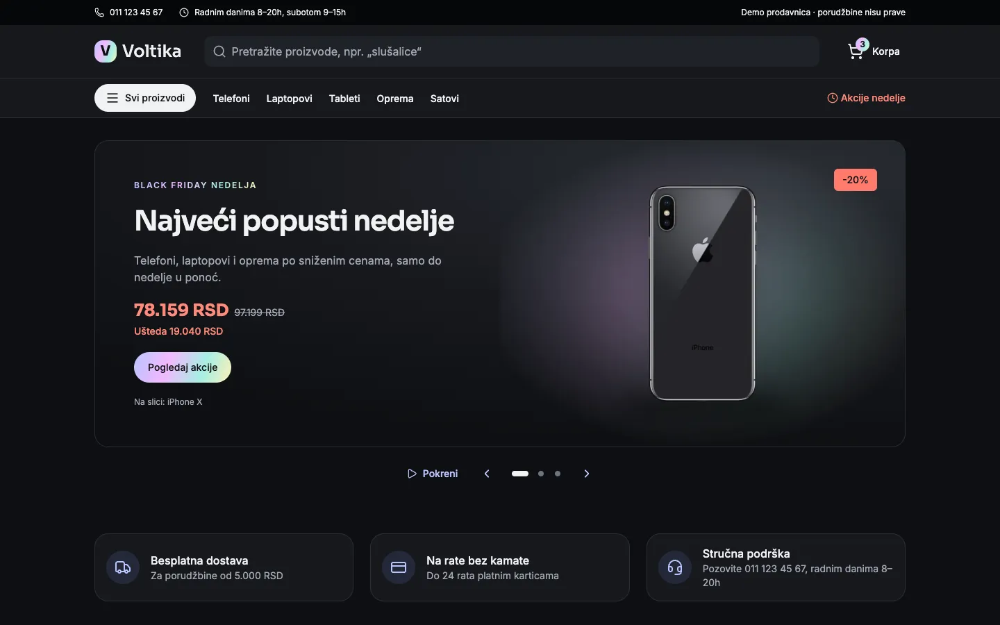
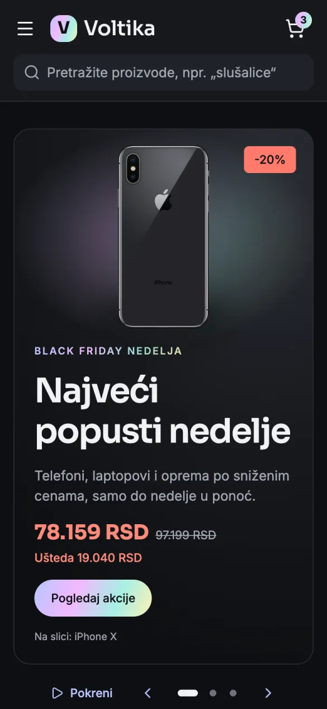
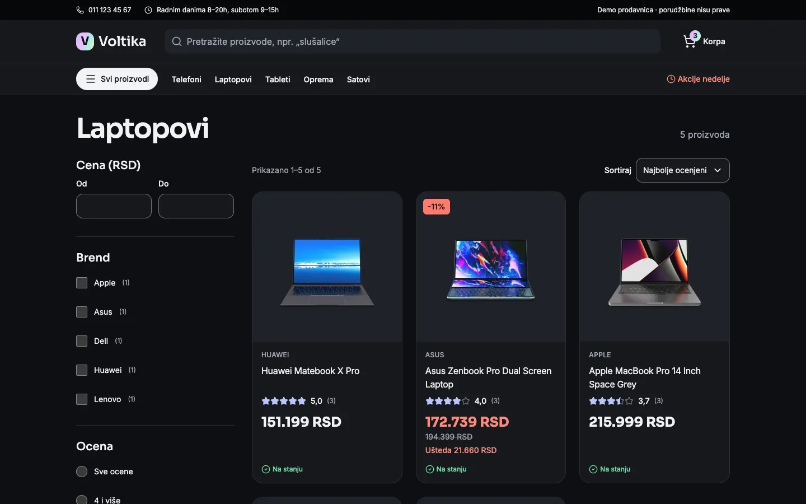
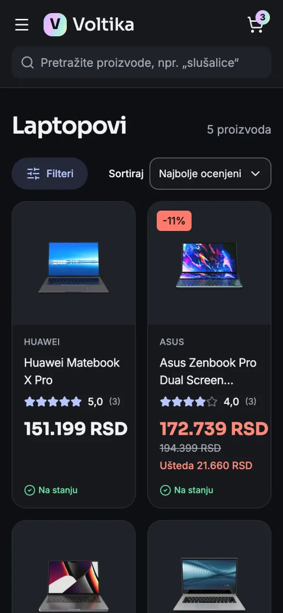
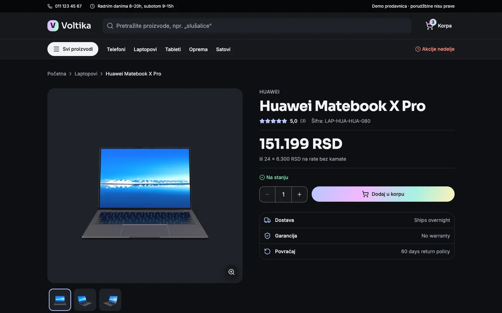
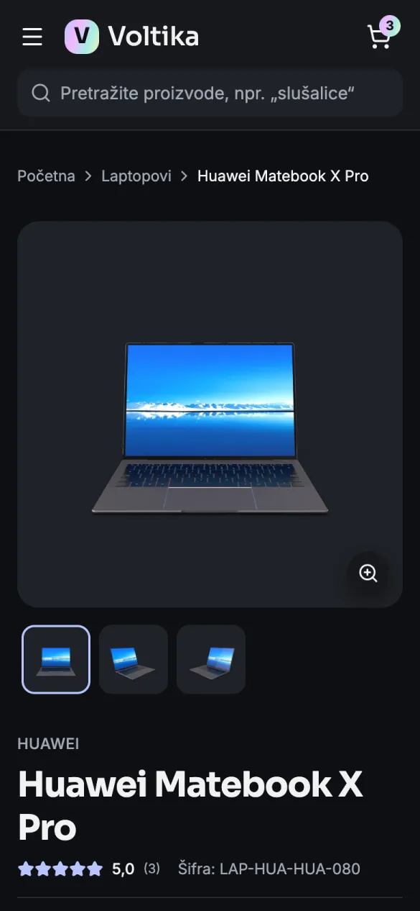
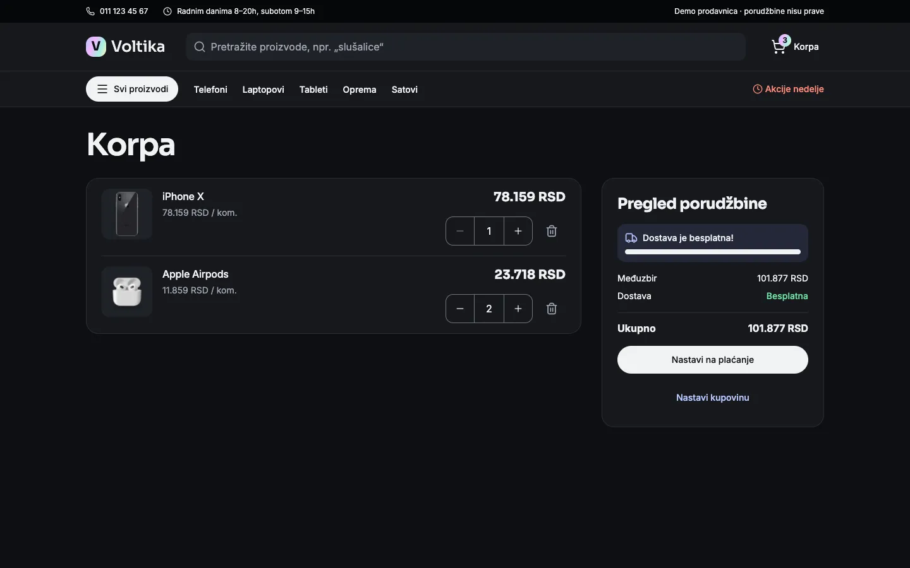
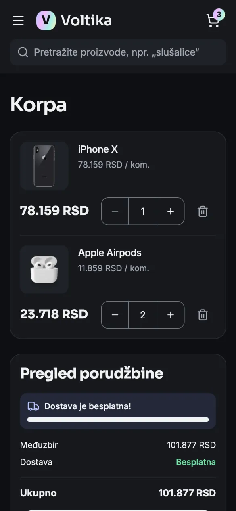

# Voltika

A demo electronics web shop, built as a front-end portfolio project with Vue 3.

**Live demo:** https://voltika-orcin.vercel.app  
**Design (Figma):** [Voltika – Design](https://www.figma.com/design/728r3CfX4JCCbcoCbBNwhK/Voltika-%E2%80%93-Design):
design system, components, wireframes, mobile and desktop mockups, and banners

> **This is not a real shop.** Nothing can be bought, no order is sent and no payment is taken.
> Product data, names and photos come from the public [DummyJSON](https://dummyjson.com) test API
> and belong to their respective owners. Prices are converted to Serbian dinars (RSD) for the demo.

## Screenshots

| Page         | Desktop (1440 px)                                                                             | Mobile (390 px)                                                                           |
| ------------ | --------------------------------------------------------------------------------------------- | ----------------------------------------------------------------------------------------- |
| Home         |                     |        |
| Product list |  |  |
| Product      |               |  |
| Cart         |        |             |

## Features

- **Product list** with filters for price, brand, rating and stock, sorting and pagination.
  All filter state lives in the URL, so a filtered view can be shared and the Back button restores it.
- **Search** in the header with suggestions while typing (debounced) and full keyboard support
  (ARIA combobox pattern).
- **Product page** with an image gallery and zoom, price with monthly installments, specifications,
  reviews in tabs, breadcrumbs and similar products.
- **Cart** saved in `localStorage`. Only product ids and quantities are stored; names and prices
  always come from the catalog, so saved data can never change a price.
- **Three-step checkout** (address, delivery and payment, review) with client-side validation and
  translated error messages.
- **Home page** with a hero slider that can be paused, weekly deals with a countdown, categories
  and top-rated products.
- Serbian by default, with English translations.

## Tech stack

| Area              | Tools                                                              |
| ----------------- | ------------------------------------------------------------------ |
| Framework         | Vue 3 (Composition API, `<script setup>`), Vite                    |
| Routing and state | Vue Router (lazy-loaded pages), Pinia                              |
| Styling           | Tailwind CSS v4 with design tokens taken 1:1 from the Figma design |
| Translations      | vue-i18n (Serbian plural rules, number and date formats)           |
| Icons             | lucide-vue-next                                                    |
| Testing           | Vitest, Vue Test Utils, jsdom                                      |
| Code quality      | ESLint, Prettier                                                   |
| Hosting           | Vercel                                                             |

## Architecture

```
src/
  views/        route-level pages: compose components, fetch data through stores/composables
  components/   UI, grouped by area: ui/ (generic Base* building blocks), layout/, product/, cart/, checkout/, home/
  composables/  reusable logic: useProductFilters, useSearch, useProduct, useCheckout, useCountdown, useSeo...
  stores/       shared state (Pinia): catalog, cart
  services/     the only layer that knows about the API (DummyJSON) and maps its data
  utils/        pure functions: prices, filters, pagination, validation, cart rules, SEO data
  config/       business rules as named constants: free-shipping threshold, page size, delays...
  locales/      sr.json, en.json
```

Dependencies only point downward: views → components → composables → stores → services, and
`ui/` components never import stores or services.

Some decisions worth explaining:

- **Client-side filtering.** DummyJSON cannot combine category, search and price filters in one
  request, and the shop's categories hold about 45 products. The catalog is loaded once and
  filtered, sorted and paginated in the browser, which also makes every filter change instant.
- **URL as the source of truth for filters.** `useProductFilters` reads the filters from the query
  string and writes changes back with `router.push`; nothing else stores them.
- **Aborting stale requests.** When the user moves quickly between products, the previous request
  is aborted, so a slow old response can never replace the new product.
- **Banners built from live data.** The hero and promo banners are HTML and CSS, not flat images:
  the text stays real, translatable text. Each banner shows a product picked from the catalog by a
  rule (the biggest deal, or the best rated product in a category), so its photo and price are
  always current. Only the first slide's photo loads with high priority.

## Accessibility

The target is WCAG 2.1 AA:

- semantic HTML first, with a skip link and a logical heading order on every page;
- every control works with the keyboard and has a visible focus style;
- modal panels use the native `<dialog>` element (focus trap, Escape and focus return);
- tabs, combobox and carousel follow the WAI-ARIA Authoring Practices;
- form errors are linked to their fields and announced, and focus moves to the first invalid field;
- the hero slider can be paused and never moves on its own with `prefers-reduced-motion`.

## Browser check

A full shopping flow was run with Playwright in Chrome and WebKit (Safari's engine), on desktop
and on an iPhone 13 emulation: home slider, search suggestions, image zoom, add to cart, filters
(the bottom sheet on mobile), cart quantity, checkout validation and a complete order.
The check found that Safari collapsed the image zoom and the filter sheet to zero height; that is
fixed. Firefox has not been checked yet.

## Performance and SEO

- Lazy-loaded pages and a lazy-loaded image zoom; fonts are self-hosted and preloaded.
- Images have fixed dimensions (no layout shift) and below-the-fold images are lazy-loaded.
- Every page sets its own title and meta description; checkout, cart and the not-found page are
  marked `noindex`.
- The product page outputs `Product` and `BreadcrumbList` structured data (JSON-LD).
- Pages that show products start loading the catalog from a router guard, in parallel with
  their own JS chunk instead of after it.
- The home hero shows its holographic light as a 4 KB inlined image, so the banner is complete
  at once; the product photo fades in when the catalog arrives, and placeholders of the same
  height keep the layout still (CLS 0).

Lighthouse on mobile (simulated slow 4G), three runs on the live site:

| Page         | Performance | Accessibility | Best practices | SEO |
| ------------ | ----------- | ------------- | -------------- | --- |
| Home         | 91–98       | 100           | 100            | 100 |
| Product list | 87          | 100           | 100            | 100 |
| Product      | 86–87       | 100           | 100            | 100 |

The product list and product pages wait for the DummyJSON API before they can show their
largest image, the first product photo, which keeps them just under 90 in the simulation.
Pre-rendering those pages would remove that wait (see below).

## Getting started

Requires Node.js 22.18 or newer (see `engines` in `package.json`).

```bash
npm install
npm run dev        # start the dev server
npm run build      # production build
npm run preview    # serve the production build locally
npm run test       # run the tests once
npm run lint       # ESLint
npm run format     # Prettier
```

## Testing

More than 300 unit and component tests cover the pure helpers (prices, filters, pagination,
validation, cart rules), the stores, the composables (including timers with fake timers) and
whole pages with a mocked API: loading, empty and error states, keyboard navigation and
the checkout flow.

## What I would add next

- A real backend (for example a headless commerce API) behind the existing `services/` layer, so
  the components would not need to change.
- Real payments and order history, with user accounts.
- A wishlist and side-by-side comparison of up to three products.
- Pre-rendering of the product pages, for faster first paint and better SEO.
